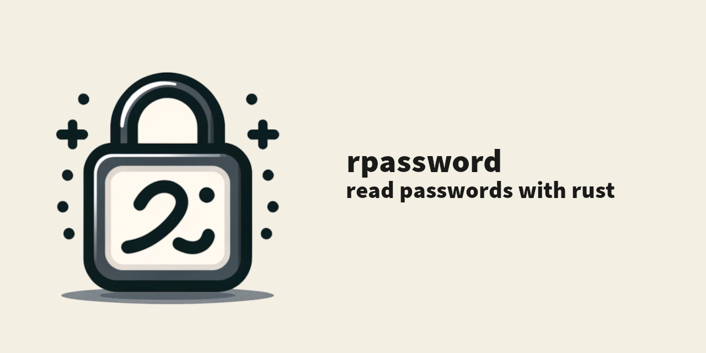

# Rustastic Password

`rpassword` makes it easy to read passwords from Rust code in console applications on all platforms, Unix, Windows, WASM and more.
It's similar to Linux's C function `getpass()` or Python's `getpass` module.



## Usage

Add `rpassword` as a dependency in Cargo.toml:

```toml
[dependencies]
rpassword = "7.5"
```

Then use it in your code:

```rust
use std::io::{Cursor, Write};
use rpassword::{ConfigBuilder};

fn main() {
    // By default, reads and writes to the console, hides password as it is typed 
    let password = rpassword::prompt_password("Your password: ").unwrap();
    println!("Your password is {}", password);
    
    // Behavior is customizable to accommodate custom use-cases and testing
    // See documentation for more details
     let config = rpassword::ConfigBuilder::new()
         .input_data("my-password\n")
         .output_discard()
         .password_feedback_mask('*')
         .build();
    
     let password = rpassword::read_password_with_config(config).unwrap();
     println!("Your password is {}", password);
}
```

See examples and docs at [https://docs.rs/rpassword](https://docs.rs/rpassword).

## Running without a controlling terminal

On Unix, `read_password()` and `prompt_password()` use `/dev/tty`, not stdin.
Redirecting stdin does not remove an existing controlling terminal. A process
started without one, such as a detached job or some CI jobs, cannot open
`/dev/tty`; the functions return the operating system's `std::io::Error`. For
example, macOS reports `Device not configured (os error 6)`. A missing or
inaccessible terminal device can also prevent these calls from working.

Choose the input and output explicitly for non-interactive use. For example, if
your application deliberately reads its password from piped stdin:

```rust,no_run
use rpassword::{ConfigBuilder, read_password_with_config};

fn main() -> std::io::Result<()> {
    let config = ConfigBuilder::new()
        .input_reader(std::io::stdin())
        .output_discard()
        .build();
    let _password = read_password_with_config(config)?;
    // Use the password without printing it.
    Ok(())
}
```

This is an explicit choice, not an automatic fallback. Reader inputs do not
configure terminal echo, so this example is intended for piped input, not a
hidden interactive prompt. If stdin already carries your application's data,
choose a different password source. For `prompt_password_with_config`, also
configure the output: its default output still uses the terminal.

See the upgrade path in [UPGRADE.md](UPGRADE.md).

## License

The source code is released under the Apache 2.0 license.
